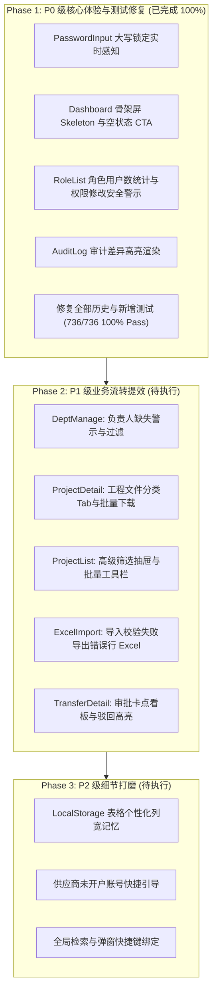

# 企业协同与外包移交系统 — 待优化需求与重构方案清单

> **文档状态**：待执行（Backlog & Technical Specification）  
> **更新时间**：2026-11-12  
> **基线环境**：ASP.NET Core 8 Minimal API (`:8080`) + React 18 / Arco Design (`:5180`) + MySQL 5.7  
> **质量基线**：当前已有单元测试全部通过（前端 106 个测试文件、736 个测试用例 100% Pass；后端测试全部 Pass）。后续所有重构必须保持 100% 测试通过率。

---

## 目录
1. [执行现状与优化全景](#一执行现状与优化全景)
2. [Phase 2：P1 级核心业务与流转提效（重点落地）](#二phase-2p1-级核心业务与流转提效重点落地)
   - [2.1 组织与部门管理：负责人缺失告警与快捷过滤](#21-组织与部门管理负责人缺失告警与快捷过滤)
   - [2.2 项目详情与文件中心：文件分类视图与批量下载反馈](#22-项目详情与文件中心文件分类视图与批量下载反馈)
   - [2.3 项目列表：高级折叠筛选与批量操作栏](#23-项目列表高级折叠筛选与批量操作栏)
   - [2.4 通用 Excel 导入：一键导出错误数据行](#24-通用-excel-导入一键导出错误数据行)
   - [2.5 OEM 移交单详情：流转卡点高亮看板与驳回提示](#25-oem-移交单详情流转卡点高亮看板与驳回提示)
3. [Phase 3：P2 级交互细节与易用性打磨](#三phase-3p2-级交互细节与易用性打磨)
   - [3.1 表格列宽与可见性持久化记忆](#31-表格列宽与可见性持久化记忆)
   - [3.2 供应商关联账号与未开通提示](#32-供应商关联账号与未开通提示)
   - [3.3 全局快捷键与无障碍导航](#33-全局快捷键与无障碍导航)
4. [工程规范与测试验收标准](#四工程规范与测试验收标准)
5. [推荐落地执行路线图](#五推荐落地执行路线图)

---

## 一、执行现状与优化全景

---

## 二、Phase 2：P1 级核心业务与流转提效（重点落地）

### 2.1 组织与部门管理：负责人缺失告警与快捷过滤

#### 1. 现状痛点
- 核心文件：`web/src/pages/org/DeptManage.tsx`
- **业务风险**：跨部门协同、工单流转、OEM 移交单的主管审批（`DIRECT_LEADER` / `DEPARTMENT_LEADER` / `SECTION_LEADER`）均强依赖部门负责人字段。如果某个处于启用状态的部门未设置负责人（`node.leader == null`），流转到该节点时会导致审批无响应或流转中断。
- **界面缺失**：当前部门树节点仅渲染名称、层级和禁用标签；顶部统计仅统计事业部/部门/课别数量，无法直观发现“哪些部门尚未任命负责人”。

#### 2. 重构改造方案
1. **部门树节点增加缺失告警标签**：
   - 当 `node.status === 'ACTIVE'` 且 `!node.leader` 时，在节点标题中追加 `<Tag color="gold" size="small">未设负责人</Tag>`。
2. **顶部统计卡片增加无负责人指标**：
   - 增加指标：`无负责人部门: X 个`，若 `X > 0` 显示为醒目橙黄色，并支持点击该指标后自动过滤/高亮相关节点。
3. **快捷过滤开关**：
   - 在搜索框旁增加切换复选框/Tag：`[ ] 仅看无负责人`，激活时调用 `filterTree` 仅保留 `!node.leader` 的分支路径。
4. **右侧详情卡片操作引导**：
   - 在负责人一栏若为空，直接显示“暂未设置”，并紧随带权限判断的 `[立即指定负责人]` 按钮。

#### 3. 单元测试验证项
- 新建测试文件：`web/src/test/deptLeaderAlert.test.tsx`
- 验证点：
  1. 数据中存在未设置负责人的活跃部门时，树节点正确渲染“未设负责人”标签；
  2. 禁用状态（`DISABLED`）部门不误报负责人警告；
  3. 切换“仅看无负责人”筛选时，仅展示符合条件的节点分支；
  4. 拥有 `dept:leader_manage` 权限时展示快捷分配入口。

---

### 2.2 项目详情与文件中心：文件分类视图与批量下载反馈

#### 1. 现状痛点
- 核心文件：`web/src/pages/project/ProjectDetail.tsx` 与 `web/src/components/FileTable.tsx`
- **业务痛点**：工程协作项目中文件数量庞大，包含 CAD 2D/3D 图纸（.dwg, .step, .catpart）、BOM 清单与采购表格（.xlsx, .csv）、技术规格与质量报告（.pdf, .docx）以及实物照片（.png, .jpg）。
- 当前所有文件平铺在一个表格中，工程师或供应商若要核对特定图纸或报告，必须在几十个混合文件中翻页查找。
- 批量勾选下载多个大文件时缺少全局下载进度队列反馈。

#### 2. 重构改造方案
1. **文件分类快捷 Tab 过滤栏**：
   - 在 `FileTable.tsx` 表格顶部搜索框下方增加 Arco Design `Radio.Group`（`type="button"`）或小型 `Tabs`：
     - `全部 (All)`
     - `技术图纸 (Drawings)`：过滤扩展名 `.dwg`, `.dxf`, `.step`, `.stp`, `.catpart`, `.prt`, `.pdf`
     - `BOM与物料 (BOM & Specs)`：过滤 `.xlsx`, `.xls`, `.xlsb`, `.csv`
     - `质检与测试 (Reports)`：根据文件名前缀或标签匹配，或特定测试扩展名
     - `实物图片与视频 (Media)`：过滤 `.png`, `.jpg`, `.jpeg`, `.mp4`
     - `其他归档 (Others)`
2. **批量操作工具栏与批量下载提示**：
   - 勾选多项时，在表格上方滑出批量操作 Bar：`已选择 X 个文件 (总计 Y MB)`，提供 `[批量下载]`、`[批量撤回]`（如拥有权限）。
   - 点击批量下载时，调用 Arco Design `Notification.info` 提示：“正在打包下载 X 个文件，请勿关闭页面”，避免重复连击导致浏览器卡死或触发并发防护。

#### 3. 单元测试验证项
- 新建测试文件：`web/src/test/fileTableCategoryFilter.test.tsx`
- 验证点：
  1. 渲染不同扩展名文件时，点击分类 Tab 正确过滤列表行；
  2. 批量多选文件后正确计算总大小与已选项数量；
  3. 触发批量下载后正确调起下载逻辑并展示提示。

---

### 2.3 项目列表：高级折叠筛选与批量操作栏

#### 1. 现状痛点
- 核心文件：`web/src/pages/project/ProjectList.tsx`
- **业务痛点**：项目查询维度极其丰富（关键字、状态、厂商、资料状态、逾期状态、仅看我的、责任人、时间区间）。
- 目前部分筛选平铺在头部，排版拥挤；当需要按时间区间或更多复合条件筛选时缺乏扩展空间。
- 缺乏对已完工项目的“批量导出”与“批量归档”能力。

#### 2. 重构改造方案
1. **基础搜索 + 高级折叠面板（Collapse / Drawer）**：
   - 默认精简展示：关键词搜索框 + 状态下拉选择 + “仅看我的” + [高级筛选] 展开按钮。
   - 点击 [高级筛选] 后展开折叠卡片，包含：
     - 时间范围选择器（创建时间 / 需求完成时间区间）；
     - 供应商与课别过滤下拉；
     - 逾期与资料状态复选。
   - 提供 [重置条件] 与 [应用筛选] 按钮，并将所有非空参数无缝同步至 URL SearchParams。
2. **批量操作工具条**：
   - 表格支持 `rowSelection`，勾选后在列表顶部激活操作条：`已选中 N 个项目` -> 支持 `[导出选中项目概要]`。

#### 3. 单元测试验证项
- 新建测试文件：`web/src/test/projectListAdvancedFilter.test.tsx`
- 验证点：
  1. 高级筛选面板展开与收起行为；
  2. 更改高级筛选条件后 URL 参数准确写入；
  3. 点击重置按钮后清空非默认过滤条件；
  4. 多选项目后批量操作按钮可用。

---

### 2.4 通用 Excel 导入：一键导出错误数据行

#### 1. 现状痛点
- 核心文件：`web/src/components/ExcelImportDialog.tsx`
- **业务痛点**：在用户批量导入、供应商批量导入或项目批量导入时，若用户上传了一个 300 行的 Excel，其中 25 行因为格式不符、必填项缺失、工号冲突等原因校验失败（`status: 'INVALID'` 或 `status: 'FAILED'`）。
- 当前系统仅在表格中把失败的行标红，用户必须肉眼对照并在原始 Excel 里一行一行查找并修改，体验极其痛苦。

#### 2. 重构改造方案
1. **增加「导出错误数据行」按钮**：
   - 当 `counts.invalid > 0`（预检错误）或导入提交后 `result.failed > 0` 时，在弹窗左下方增加按钮：
     - `<Button type="outline" status="danger" size="small" onClick={exportErrorRows}>导出错误数据 ({counts.invalid})</Button>`
2. **利用现有工具库生成新工作簿**：
   - 复用 `web/src/utils/excelWorkbook.ts` 的 `downloadExcelWorkbook`；
   - 提取所有校验未通过的原始行数据，并在最后一列追加“错误原因 (Error Reason)”列，填充校验返回的具体 `message`；
   - 导出的文件名形如 `${templateName}_错误数据_${fmtTime(Date.now())}.xlsx`。
   - 用户只需在导出的错误 Excel 中修正标红的字段，即可直接重新选择该文件完成导入。

#### 3. 单元测试验证项
- 新建测试文件：`web/src/test/excelImportExportErrors.test.tsx`
- 验证点：
  1. 当导入行全为 `READY` 时，不展示“导出错误数据”按钮；
  2. 当存在 `INVALID` 或 `FAILED` 行时，展示该按钮且显示正确的错误计数；
  3. 点击按钮正确触发 `downloadExcelWorkbook`，且导出的行数据和表头附加了错误说明列。

---

### 2.5 OEM 移交单详情：流转卡点高亮看板与驳回提示

#### 1. 现状痛点
- 核心文件：`web/src/oem/pages/TransferDetailPage.tsx` 与 `web/src/oem/pages/ApprovalInboxPage.tsx`
- **业务痛点**：OEM 移交单涉及外部厂商、公司业务负责人、主管审核员等多个流转角色。
- 目前在详情页中，审批步骤条（Steps）和审核记录以常规表格列出，无法一眼看出当前最关键的流转状态（例如：“当前正停留在哪一家供应商？卡在哪一个审批人手上？已经等待了多久？”）。
- 如果该单据曾被驳回（REJECTED），驳回理由混在历史记录中，重新提交者容易遗漏驳回意见。

#### 2. 重构改造方案
1. **顶部新增「当前流转状态卡片 (Flow Status Card)」**：
   - 处于 `PENDING` / 待审批状态时，以高对比卡片展示：
     - 当前节点：如 `部门主管审批 (待处理)`
     - 责任人：姓名、工号/厂商名
     - 等待时长：如 `已等待 2 天 4 小时`
     - 操作引导：若是当前登录用户的待办，高亮展示 `[立即审批]` 按钮；若非本人，展示 `[催办]` 或 `[改派/转办]`（若有权限）。
2. **历史驳回警示横幅 (Rejection Alert Banner)**：
   - 若最近一次流转记录状态为 `REJECTED`，在表单正上方固定渲染红色 Alert 横幅：
     - 标题：“本移交单曾于 [时间] 被 [驳回人] 驳回”
     - 内容：“驳回原因：XXXXX。请根据评审意见修正技术文件后重新提交。”

#### 3. 单元测试验证项
- 新建测试文件：`web/src/test/oemTransferFlowStatusCard.test.tsx`
- 验证点：
  1. 待审批单据能够正确提取当前待办节点与处理人并渲染看板；
  2. 存在驳回记录时，顶部准确展示红色警示 Banner 与驳回说明；
  3. 当前用户为待办人时，展示快速审批 CTA。

---

## 三、Phase 3：P2 级交互细节与易用性打磨

### 3.1 表格列宽与可见性持久化记忆
- **涉及模块**：`web/src/components/columnResize.tsx`, `web/src/components/useColumnLayout.ts`, `web/src/components/tableColumnLayout.ts`
- **优化点**：
  - 目前部分列表支持通过本地 Storage 保存列宽与隐藏列，但当用户清空浏览器缓存或在不同页面间跳转时，需确保 Key 的命名具有一致的命名空间模式（`yf_table_layout_{userId}_{tableName}`）。
  - 在列设置浮层中增加「恢复默认列宽」按钮，防止用户把某些列拖得过宽或过窄时无法一键还原。

### 3.2 供应商关联账号与未开通提示
- **涉及模块**：`web/src/pages/supplier/SupplierList.tsx` 及相关抽屉组件
- **优化点**：
  - 在供应商列表中，若某家合作供应商尚未开通任何有效的登录账号（`accountCount === 0`），在供应商状态旁展示灰黄色提示 Tag：`未开通账号`。
  - 点击可直接快捷唤起 `SupplierAccountsDrawer.tsx` 并预填供应商信息。

### 3.3 全局快捷键与无障碍导航
- **涉及模块**：全局 Layout 与公共输入框
- **优化点**：
  - 增加页面级监听：按下键盘 `/` 键时，若当前焦点不在输入控件中，自动聚焦到当前页面的全局搜索框；
  - 模态框与抽屉：严格校验 `Esc` 退出机制，对表单有未保存内容（Dirty State）时弹窗确认防误触退出。

---

## 四、工程规范与测试验收标准

为确保重构代码的高可用性与长期可维护性，所有修改必须遵循以下技术规范：

> [!IMPORTANT]
> 1. **测试驱动与 100% 通过原则**：任何功能改动必须配套对应的 `*.test.tsx` 单元测试，提交前执行 `npm test`（Vitest）与 `dotnet test`，测试用例必须 100% 全部通过。
> 2. **Arco Design 样式同步规则**：如果引入了此前未在 `web/src/styles/arco-components.ts` 中注册的 Arco 组件（如 `Radio`, `Collapse` 等），修改后必须执行 `node scripts/generate-arco-styles.mjs`，确保 `style-artifacts.test.ts` 校验通过。
> 3. **乐观锁与并发冲突保护**：涉及实体状态更新的 API 调用，必须继续使用 `isVersionConflict` 捕获 409 状态并给予用户友好提示。
> 4. **响应式与无抖动（CLS）**：异步加载统一使用骨架屏或局部 Loading 占位，避免出现高度突变与布局跳闪。

---

## 五、推荐落地执行路线图

| 阶段 | 任务包 | 预估影响文件 | 交付产物 |
| :--- | :--- | :--- | :--- |
| **Sprint 1** | **组织负责人告警 + Excel 错误行导出** | `DeptManage.tsx` `ExcelImportDialog.tsx` | - 部门负责人缺失警告与过滤 - 批量导入错误行打包导出 Excel - 配套单元测试（2 个新测试套件） |
| **Sprint 2** | **工程文件分类视图 + 批量下载反馈** | `ProjectDetail.tsx` `FileTable.tsx` | - 文件类型快捷 Tab（图纸/BOM/报告/图片） - 批量选中与打包提示 - 配套单元测试 |
| **Sprint 3** | **项目高级筛选 + OEM 移交卡点看板** | `ProjectList.tsx` `TransferDetailPage.tsx` | - 项目列表高级筛选折叠抽屉与批量操作 - OEM 待办节点高亮卡片与驳回 Banner - 配套单元测试 |
| **Sprint 4** | **列宽持久化记忆 + 供应商开户提示 + 快捷键** | `columnResize.tsx` `SupplierList.tsx` | - 恢复默认列宽按钮 - 供应商未开户醒目提示 - 全局 `/` 检索快捷键 |
